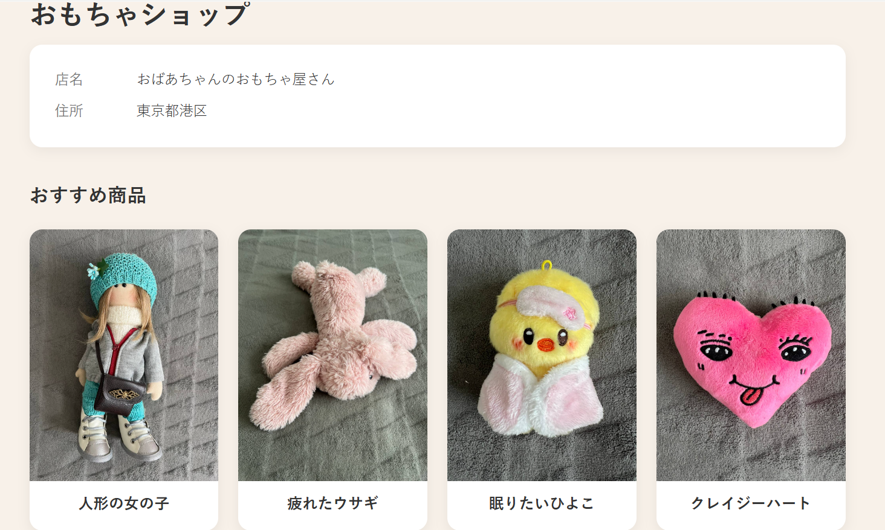
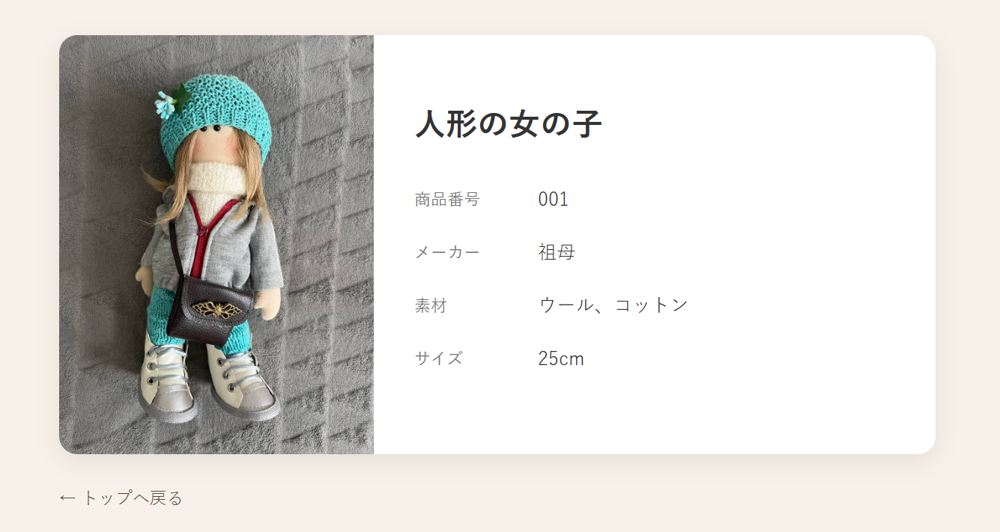

# Knitted Toy Shop（おばあちゃんのおもちゃ屋さん）

**A small demo shop website for knitted toys, built with Spring Boot and Thymeleaf.**
Spring Boot と Thymeleaf で作成した、手編みのおもちゃを紹介するデモショップサイトです（専門学校の授業課題・個人制作）。





## Features / 主な機能

- Top page with shop information and a product list / 店舗情報と商品一覧のトップページ
- Product detail pages via URL path variables (`/item/{id}`) / URLパス変数による商品詳細ページ
- Product data passed from the controller to Thymeleaf templates (`Model`) / コントローラーからテンプレートへのデータ受け渡し
- Static images served from `resources/static` / 静的リソースによる商品画像の表示

## Tech stack / 使用技術

Java 21, Spring Boot (Spring MVC), Thymeleaf, Gradle, HTML/CSS

## How to run / 起動方法

```bash
./gradlew bootRun        # Windows: gradlew.bat bootRun
```

Then open http://localhost:8080

## What I learned / 学んだこと

- Spring MVC request mapping and path variables
- Passing data from a controller to a Thymeleaf view
- Project structure of a Spring Boot application (Gradle)

## Author / 作者

Anna Zorych — [LinkedIn](https://www.linkedin.com/in/anna-zorych/)
